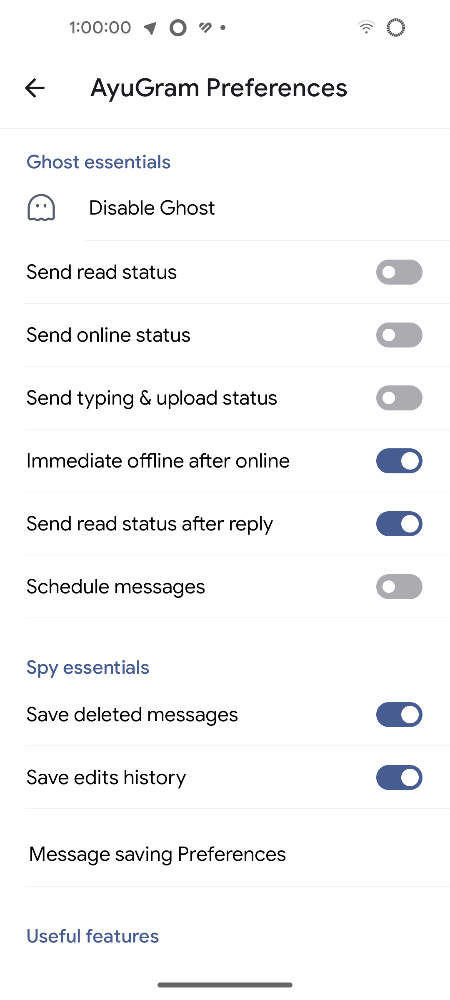
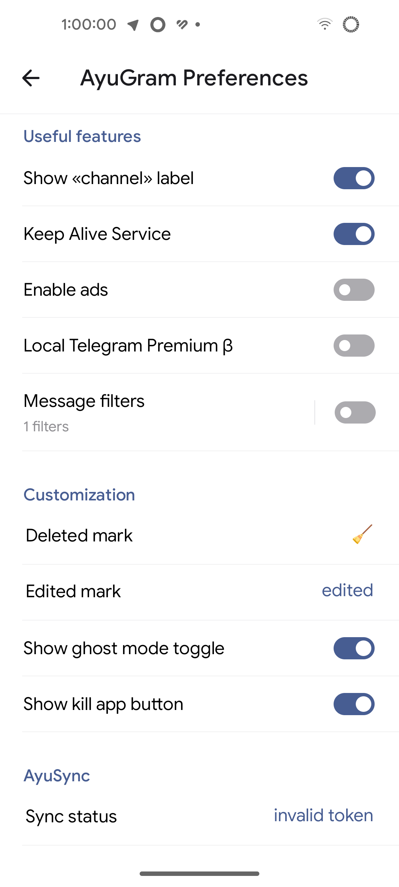
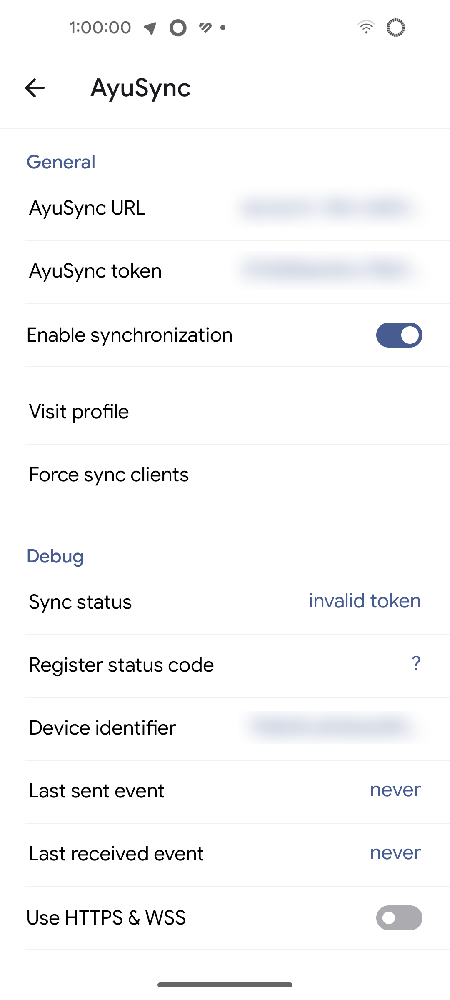
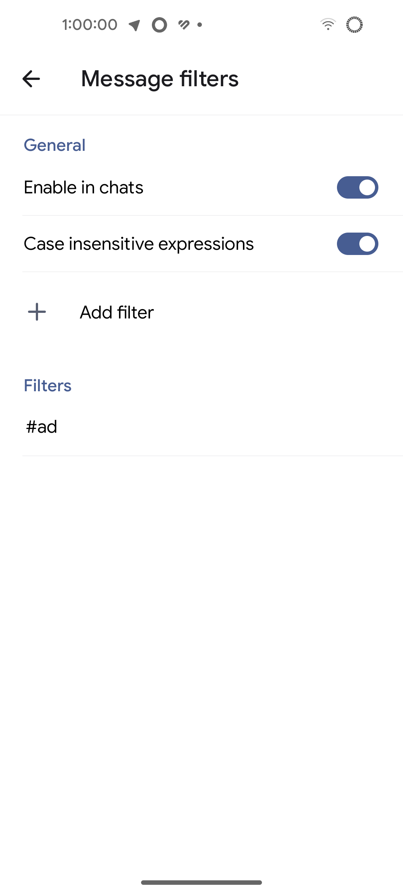
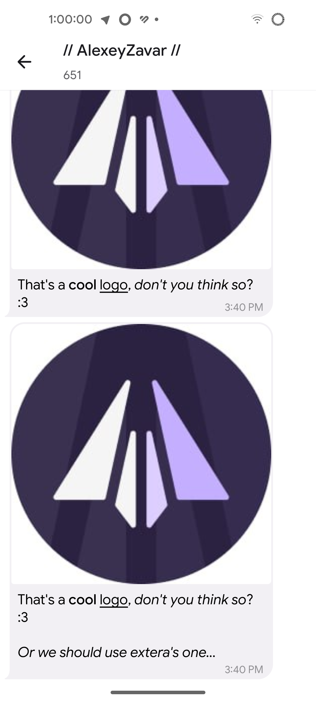

# AyuGram for Android


## What's this fork even about?

**Is it just exteraGram+Telegraher?**

**AyuGram4A** is a fork of [exteraGram](https://github.com/exteraSquad/exteraGram) with
some patches from [Telegraher](https://github.com/nikitasius/Telegraher).

But it's not just exteraGram with Telegraher's commits, **it's a fully reworked version**.

The main difference between AyuGram and Telegraher is that AyuGram **saves** your messages history,
while Telegraher just **caches** them.
It means that you can clean your cache and still have all saved messages.

Also, AyuGram has **full ghost mode**.
It allows you to hide your online status from other users, even if you send them
a message.

*And, well, it's not an Iranian Telegram fork with floating TV or something.*

## Features list

### Telegraher's patches:

- Built with official keys
- Screenshots in secret chats
- No emulator detection
- No ads

### Reworked Telegraher's patches:

- Save chats where you were banned/kicked
- Expire button for TTL photos/videos
- ...something else probably

### Our features:

- Full ghost mode (flexible)
- Messages history (flexible)
- Message filters (e.g. hide ads)
- Customizable edited/deleted marks
- Local Telegram Premium
- Sync read states and message history with AyuSync
- Up to stream Telegram version (*snidely*)

Note that we use **Crashlytics**.
If you don't want to send crash reports, you can disable it in **exteraGram Preferences**.

**AyuGram4A** does **NOT** include proprietary **exteraGram** features.

## Preview

💖 **Made with extera's Monet theme.**

 

 

 

## Downloads?

Follow our **[Telegram channel](https://t.me/ayugram1338)** and join our [chat](https://t.me/ayugramchat)!

Preview versions can be downloaded
from the **[dedicated topic](https://t.me/ayugramchat/1238)**.

## Want to throw some money?

Developing AyuGram is not such a simple task.
**We'd be grateful for any donation <3**

All available methods can be found **[here](https://ayusync.cloud/ui/donate)**.

## AyuSync? What is it?

**AyuSync** is our synchronization service.
You can either use official server or host your own.
It can sync read states and message history.

Server backend can be found **[here](https://github.com/AyuGram/AyuSyncBackend)**.

## Want to contribute?

I'd be grateful for any contribution, since I don't really like Java. :)

**Work on any feature you want.**

## Want to fork?

Well, just fork it.

**But please, don't forget to mention us in your README.**

## Build HorusGram for Android

Use Android Studio with JDK 17 and install these SDK components from SDK Manager:

- Android SDK Platform 33
- Android SDK Build-Tools 33.0.1
- Android NDK 21.4.7075529
- CMake 3.10.2.4988404

Clone this repository and open its root folder in Android Studio. The private AyuGram
submodule is optional; this fork includes open stubs for builds without it.

Create an `API_KEYS` file in the repository root. It is ignored by Git. Keep your own
signing keystore outside the repository and point `SIGNING_KEY_STORE` to it so repeated
local builds can update the same installation on your phone:

```powershell
keytool -genkeypair -v -keystore "C:\Users\you\keys\horusgram.jks" -storetype JKS -keyalg RSA -keysize 2048 -validity 10000 -alias horusgram
```

Use the keystore and key passwords entered by `keytool` in the `API_KEYS` file below.

```properties
APP_ID = 6
APP_HASH = "eb06d4abfb49dc3eeb1aeb98ae0f581e"
MAPS_V2_API =
SIGNING_KEY_STORE = C:/Users/you/keys/horusgram.jks
SIGNING_KEY_PASSWORD = your-key-password
SIGNING_KEY_ALIAS = your-key-alias
SIGNING_KEY_STORE_PASSWORD = your-store-password
```

For the fastest phone preview, connect an Android device with USB debugging enabled,
select the `betaDebug` variant, and run:

```powershell
.\gradlew.bat installBetaDebug
```

Or build the APK without installing it:

```powershell
.\gradlew.bat assembleBetaDebug
```

The preview APK is written to
`TMessagesProj/build/outputs/apk/beta/debug/` and includes ARM 32-bit and 64-bit
libraries. `betaDebug` skips release shrinking, so use this for design iteration.
On Android 8.0 or newer, Android Studio's **Apply Changes** can update supported
code edits while the app is running; manifest, native-library, and some resource
changes still need a normal Run/restart.

For the full release APK, which takes longer because it builds all four ABIs and
shrinks the app, run:

```powershell
.\gradlew.bat assembleAfatRelease
```

The release APK is written to `TMessagesProj/build/outputs/apk/afat/release/`.

For repeatable GitHub Actions installs, add these repository secrets:
`ANDROID_KEYSTORE_BASE64`, `ANDROID_KEYSTORE_PASSWORD`, `ANDROID_KEY_ALIAS`, and
`ANDROID_KEY_PASSWORD`. Encode the private keystore for the first secret with:

```powershell
[Convert]::ToBase64String([IO.File]::ReadAllBytes("C:\Users\you\keys\horusgram.jks"))
```

Without these secrets, Actions signs each APK with a new temporary key; Android
will reject installing it over a previous CI build.

To inspect the actual native Android UI, run the app on the phone and open Android
Studio's **Layout Inspector** from the Running Devices window. It can inspect this
project's runtime Views, which are built in Java rather than Compose.

## Localization

[](https://crowdin.com/project/ayugram)
[](https://crowdin.com/project/exteralocales)

We have our own **[Crowdin](https://crowdin.com/project/ayugram)**.

But since **AyuGram** is based on **exteraGram**, also join their project
at **[Crowdin](https://crowdin.com/project/exteralocales)**!

## Credits

- **[exteraGram](https://github.com/exteraSquad/exteraGram)**
- [Telegraher](https://github.com/nikitasius/Telegraher)
- [Cherrygram](https://github.com/arsLan4k1390/Cherrygram)
- [Nagram](https://github.com/NextAlone/Nagram)
- [Telegram FOSS](https://github.com/Telegram-FOSS-Team/Telegram-FOSS)
